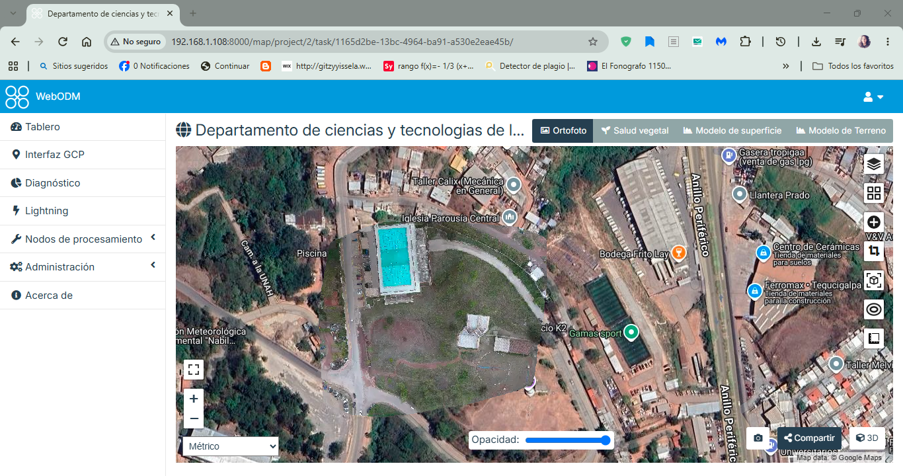
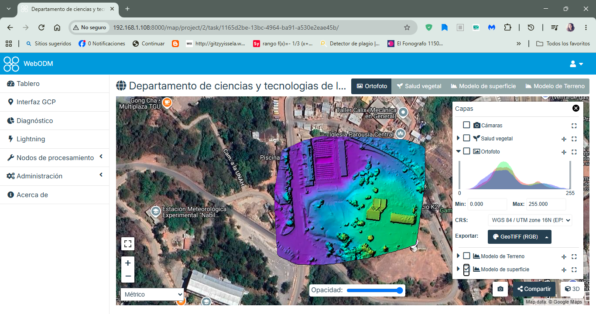
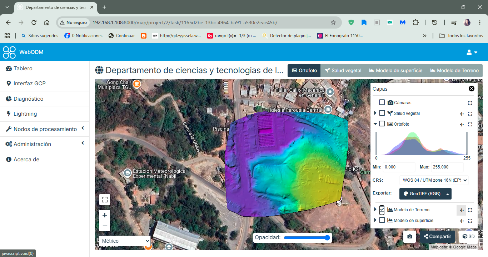
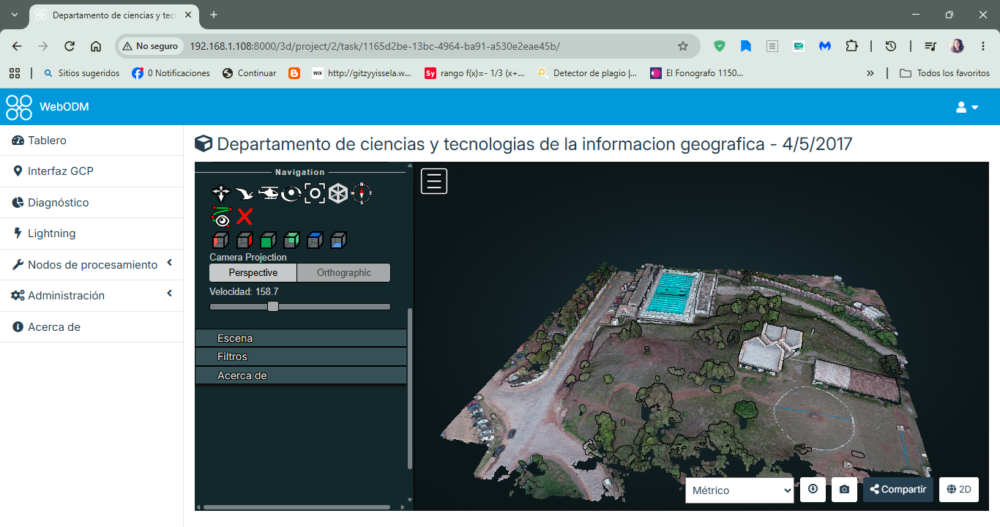

# Examen Unidad I – Servicio web para el procesamiento fotogramétrico

**Curso:** CTE 334 – Desarrollo de Aplicaciones SIG
**Universidad:** Universidad Nacional Autónoma de Honduras (UNAH), Facultad de Ciencias Espaciales
**Estudiante:** Gitzy Andrade (`gitzmar-hue`)

Este repositorio es un fork de `jcaceres85/WebODM`. En él se registran los cambios necesarios para poner a correr **WebODM** (OpenDroneMap) en una máquina virtual con Ubuntu Server y procesar las imágenes del examen.

## 1. Entorno utilizado

| Elemento | Detalle |
|---|---|
| Virtualización | VirtualBox |
| Sistema operativo | Ubuntu Server 26.04.1 LTS |
| Recursos de la VM | 8 GB de RAM, 4 CPU, disco de 50 GB |
| Red | Adaptador puente (IP de la VM: `192.168.1.108`) |
| Usuario de trabajo | `webodm` |
| Docker | 29.9.3 |
| Carpeta del proyecto | `/opt/WebODM` |

## 2. Pasos realizados

1. Creación de la máquina virtual con Ubuntu Server 26.04 y acceso por SSH.
2. Instalación de Docker y de sus complementos desde el repositorio oficial. Fue necesario sincronizar la hora de la máquina virtual, porque un reloj atrasado hacía que `apt` rechazara los repositorios con el error *«Release file ... is not valid yet»*.
3. Creación del directorio `/opt/WebODM` con el propietario y los permisos indicados en la guía.
4. Clonación de este repositorio (fork) en `/opt/WebODM`.
5. Edición del archivo `.env` (ver sección 3).
6. Lanzamiento de los servicios con `./webodm.sh start --detached`.
7. Acceso al servicio desde el navegador en `http://192.168.1.108:8000`.

## 3. Cambios registrados en el repositorio

| Archivo | Cambio | Motivo |
|---|---|---|
| `.env` | `WO_HOST=localhost` pasó a `WO_HOST=192.168.1.108` | Indicado en la guía: usar la IP de la máquina virtual. |
| `docker-compose.yml` | La imagen de los servicios `webapp` y `worker` pasó de `webodm/webodm_webapp` (etiqueta `latest`) a `opendronemap/webodm_webapp:3.1.3` | Con `latest` el servicio no arrancaba: ver explicación abajo. |

### Por qué se fijó la versión de `webodm_webapp`

La primera vez que se lanzaron los servicios, la página de WebODM se quedó en una pantalla azul de carga. El registro de la `webapp` (`docker logs webapp`) mostraba:

- `relation "auth_user" does not exist` (las tablas de la base de datos no se habían creado).
- `PostgreSQL 14 or later is required (found 9.5.25)`.

El diagnóstico fue el siguiente:

- La imagen `webodm/webodm_db:latest` fue creada el 2 de septiembre de 2021 y contiene PostgreSQL 9.5.
- La imagen `webodm/webodm_webapp:latest` fue creada el 9 de noviembre de 2026, y su Django exige PostgreSQL 14 o superior. Esa comprobación está en `django/db/backends/base/base.py`.
- El `docker-compose.yml` del fork era idéntico al de WebODM, por lo que el desajuste estaba en las imágenes publicadas y no en la configuración.

La solución fue fijar la versión `3.1.3` de la aplicación, tomada de `opendronemap/webodm_webapp`, que es compatible con la imagen de base de datos. Después de ese cambio las migraciones se aplicaron y el servicio inició con normalidad.

### Ajuste del nodo de procesamiento

Con esa versión de la aplicación, el nodo de procesamiento aparecía como desconectado porque estaba registrado con el nombre de host `webodm-node-odm-1`. Se corrigió en la interfaz de WebODM (*Nodos de procesamiento → Editar*) usando el nombre real del contenedor: `node-odx-1`, puerto `3000`. Tras el cambio el nodo quedó en línea (motor `odx` 3.8.6, API 2.4.0).

## 4. Procesamiento de las imágenes

- **Proyecto:** CTE-334 Examen 01
- **Imágenes:** 40 (todas reconstruidas)
- **Opciones:** preset *DSM + DTM*
- **Tiempo de procesamiento:** unos 47 minutos
- **Puntos de la nube densa:** 5 312 467
- **Distancia de muestreo en el terreno (GSD) promedio:** 2,46 cm
- **Error GPS:** 1,08 m

El informe de calidad completo generado por WebODM está en la carpeta `evidencias/`.

## 5. Resultados (capturas desde el navegador)

Todas las capturas muestran el servicio funcionando en `192.168.1.108:8000`.

### a. Ortofoto

### b. Modelo de superficie (DSM)

### c. Modelo de terreno (DTM)

### d. Modelo 3D

## 6. Material adicional

- `evidencias/informe_calidad_webodm.pdf`: informe de calidad generado por WebODM (ODX 3.8.6).
- `evidencias/extra_ortofoto_snapshot.png`: imagen de la ortofoto exportada con el botón de cámara de WebODM.
